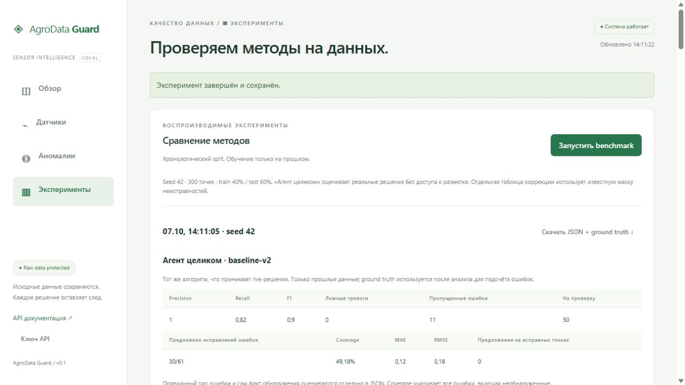

# AgroData Guard

**Рабочий прототип системы контроля качества данных аграрных датчиков.**
Приложение обнаруживает подозрительные показания, предлагает варианты коррекции
и сохраняет решения человека, не переписывая исходные измерения. Python 3.12+.

Этот репозиторий содержит программный модуль анализа, симулятор, веб-интерфейс
и локального ИИ-агента. Беспроводная mesh-сеть разрабатывается отдельно и сюда
не входит. В демонстрации используются виртуальные датчики; интеграция с физической
сетью и проверка на полевых данных остаются отдельным этапом.

## Посмотреть проект без установки



По этой странице можно познакомиться с проектом и его исходным кодом.
Для работы с датчиками и Qwen приложение нужно запустить на своём компьютере:
GitHub не запускает Python-сервер и локальную модель при открытии репозитория.

* Приём измерений через HTTP, MQTT-шлюз и CSV.
* Проверка диапазона, скорости изменения, отклонений, залипания и тренда.
* Раздельное хранение исходного значения, предложения и принятого исправления.
* Ручная проверка с журналом решений и защитой от устаревшего изменения.
* Воспроизводимые эксперименты на сигналах с известными неисправностями.
* Локальный ИИ, который изучает данные через разрешённые инструменты.

## Конференция и публикация

**III место** в треке «Студенты и аспиранты» секции № 8 «Аналитик данных в АПК»
IV Международной научно-практической конференции
«Цифровые компетенции - сельскому хозяйству», Москва, 23 сентября 2026 года.

Докладчик - **Алексеев Владимир Леонидович** (индивидуальное выступление).
Тема доклада: «Модель интеллектуального анализа и корректировки искажённых
и пропущенных данных АПК». Научный руководитель - Семенова С. О.

Источник сведений - протокол секции от 23.09.2026, приложение с итогами конкурса.
Протокол также предусматривает допуск докладов к публикации в сборнике при
соблюдении требований к оформлению. Статья планируется к публикации;
библиографическая ссылка будет добавлена после выхода сборника.
Призовое место относится к докладу, а репозиторий содержит развиваемую реализацию проекта.

## Локальный ИИ агент

Добавлен локальный **ИИ-агент на Qwen3 через Ollama**: он сам запрашивает историю,
изучает аномалии, объясняет выводы и готовит предложения для ручной проверки.
Запуск на Windows: `.\start-local-agent.ps1`, затем раздел «ИИ-агент».
Первая загрузка требует интернета и места под модель; далее ключ и платный API
не нужны. [Настройка и устройство агента](docs/AI_AGENT.md).

## Быстрый локальный запуск

Windows PowerShell, из корня проекта:

```powershell
py -3.12 -m venv .venv
.\.venv\Scripts\python.exe -m pip install -r requirements.lock
.\.venv\Scripts\python.exe -m pip install -e '.[dev]'
.\.venv\Scripts\agroguard.exe serve --demo
```

Linux/macOS:

```sh
python3.12 -m venv .venv
.venv/bin/python -m pip install -r requirements.lock
.venv/bin/python -m pip install -e '.[dev]'
.venv/bin/agroguard serve --demo
```

Открыть http://127.0.0.1:8000. Swagger: http://127.0.0.1:8000/docs.
Без `--demo` симулятор автоматически не запускается; при первом запуске база пустая.
Ранее сохранённые данные остаются в базе. Демо можно запустить кнопкой в интерфейсе.
Первая секунда запуска демо создаёт час истории через настоящий ingestion.
Далее синтетические часы идут в 30 раз быстрее. Их время может оказаться в будущем
относительно wall clock; это явно отображается в UI.

Если Python отсутствует, сначала установите Python 3.12+.

## Docker

```powershell
Copy-Item .env.example .env
# При необходимости измените API_KEY в .env.
docker compose up --build
```

На Unix вместо Copy-Item: `cp .env.example .env`.
Откройте dashboard и введите API_KEY из `.env`. Ключ остаётся только в памяти вкладки.
Порт опубликован на loopback. Данные - в Docker volume `guard-data`.
Остановка: `docker compose down` (без `-v`, чтобы сохранить БД).
MQTT вариант: `docker compose --profile mqtt up --build`.

## Демонстрация за несколько минут

1. Запустите `agroguard serve --demo`: появятся 2 узла и 6 датчиков.
2. В «Лаборатории сигналов» выберите temperature, Spike, 1 точку, величину 25.
3. Нажмите «Инжектировать неисправность». В течение 2–5 секунд появится аномалия.
4. Откройте «Аномалии», нажмите время события. Посмотрите raw, предложение,
   два score, график контекста и объяснение. Это эвристические score, не вероятности.
5. Введите имя и нажмите «Принять». Raw останется неизменным, accepted value и
   review сохранятся. Можно отклонить или повторно отправить на проверку - вся история остаётся.
6. Повторите для missing (12 точек), stuck (18 точек), drift (18 точек, magnitude 30).
   Залипание требует не менее 8 одинаковых наблюдений; длительная потеря данных
   приведёт к отказу от автоматического предложения.
7. В «Экспериментах» запустите benchmark. Сравните F1/FPR, delay, MAE/RMSE и coverage,
   скачайте JSON с ground truth, конфигурацией и версиями библиотек.

Принятие не гарантируется для каждого сбоя: отсутствие предложения при слабом
контексте - штатное безопасное решение. Для такого случая можно ввести ручное значение.

## Что реализовано

* Versioned HTTP ingestion, batch, UTC, idempotency, late messages, validation, atomic rollback.
* SQLite/SQLAlchemy, immutable raw, append-only review, optimistic version check.
* Настраиваемые сигналы, cadence, nodes, суточная периодичность, шум и корреляция фаз.
* Fault injection: missing/spike/noise/stuck/bias/drift и отдельный ground truth.
* Range, rate, Z-score, robust Z, IQR, rolling noise, stuck, trend и Isolation Forest.
* Отдельные diagnosis, correction и policy; auto-correct выключен по умолчанию.
* Median/mean/forward fill online; linear/time interpolation/backward fill offline.
* Dashboard: обзор, история, anomalies/details, review, experiments и графики.
* CSV adapter и MQTT→HTTP gateway с persistent spool, ACK/reconnect, quarantine.
* CLI, OpenAPI, health/status, JSON logging, bounded requests и API key.

## Тесты и benchmark

```powershell
.\.venv\Scripts\python.exe -m pytest
.\.venv\Scripts\ruff.exe check agroguard tests
.\.venv\Scripts\agroguard.exe benchmark --seed 42 --size 300 --output artifacts/benchmark
.\.venv\Scripts\agroguard.exe evaluate --output artifacts/quality
```

CLI сохраняет JSON и Markdown отчёт локально. Dashboard сохраняет отчёт в БД.
Benchmark - controlled synthetic experiment; он не выбирает «лучшую модель» заранее.
Раздел `pipeline` оценивает весь production-агент: обнаружение, диагноз, каузальную
коррекцию и решения, без ground truth во входах анализа. Отдельные таблицы correctors
используют известную маску ошибок и явно помечают offline-методы; их результаты
нельзя считать end-to-end качеством агента. Isolation Forest ограничен при вырожденном распределении.

Версия `baseline-v2` распознаёт возврат после одиночного выброса, сравнивает новый
тренд с предшествующим и сбрасывает статистический контекст после длинного разрыва.
Команда `evaluate` сравнивает прежние и текущие правила на десяти сценариях и нескольких
seed. На 50 синтетических сценариях FP снизились с 1017 до 227 при неизменных 483 TP;
ещё 50 сценариев дали сходный результат. Это проверка регрессий, не оценка физических
датчиков. Методика и оставшиеся ошибки: [качество v2](docs/QUALITY_V2.md).

Отдельный источник через настоящий HTTP транспорт:

```powershell
.\.venv\Scripts\agroguard.exe simulate --scenario --steps 120 --interval 1
.\.venv\Scripts\agroguard.exe import-csv config/example.csv --mapping config/csv-mapping.json
```

## Структура

```text
agroguard/
  api.py                 REST API, lifecycle, request boundary
  schemas.py, config.py  контракт и проверяемая конфигурация
  database.py            ORM, schema revision, защита raw
  service.py             транзакции ingestion и review
  engine.py              общий pipeline ingestion и оценки качества
  detectors.py           baseline registry и diagnosis
  correctors.py          causal/offline correction registry
  policy.py              decision engine
  simulator.py, demo.py  сигналы, faults, live demo
  sources.py, cli.py     CSV/HTTP/MQTT и команды запуска
  benchmark.py           эксперименты и метрики
  evaluation.py          каузальный replay production-агента
  quality_suite.py       сравнение правил на regression-сценариях
  static/                dashboard без CDN и fake data
config/                   CSV mapping и локальный broker
tests/                    unit + integration + end-to-end
docs/                     контракт сети, API, ограничения, проверка
```

## Реальные датчики и второй участник

ML-ядро и dashboard менять не требуется. Gateway второго участника должен:

* присвоить устойчивые sensor_id/node_id; один канал = один sensor_id;
* переводить device time в ISO 8601 с timezone и единицы в договорённые canonical units;
* отправлять SensorMeasurement v1 по HTTP или MQTT;
* сохранять measurement_id при повторе и буферизовать до подтверждения;
* указывать `value: null` при известном пропуске и source quality при аппаратной ошибке;
* сохранять свои network events отдельно от измерений, не подменять их синтетическим raw;
* согласовать cadence, физические диапазоны, синхронизацию часов и новые типы в config.

Подробности: [контракт сети](docs/SENSOR_CONTRACT.md), [архитектура](ARCHITECTURE.md),
[разработка](DEVELOPMENT.md), [ограничения](docs/LIMITATIONS.md).

Машиночитаемая [JSON Schema v1](docs/sensor-measurement-v1.schema.json) подходит
для contract validation gateway на другом языке. [Проверки](docs/VERIFICATION.md)
фиксируют фактически выполненные сценарии и непроверенные среды.

## Основания выбора стека

FastAPI даёт request validation и OpenAPI; SQLAlchemy позволяет менять DB URL и
драйвер без изменения доменной логики; sklearn предоставляет воспроизводимый baseline.
Использованы официальные документы [FastAPI](https://fastapi.tiangolo.com/tutorial/sql-databases/),
[SQLAlchemy](https://docs.sqlalchemy.org/en/20/core/engines.html) и
[IsolationForest](https://scikit-learn.org/stable/modules/generated/sklearn.ensemble.IsolationForest.html).
